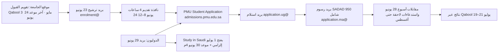

# ربط نتائج التدقيق بسياق البريد (Gmail) — مواضيع القبول

**التاريخ:** 2026-10-10 · **الإذن:** طلبتَ صراحةً الربط بسياق البريد · **الوصول:** قراءة فقط (بحث وقراءة)؛ لم يُرسَل أو يُوسَم أو يُحذَف أي بريد.

## 1. ضوابط الخصوصية المطبّقة
- **لم أفتح** رسائل التقديم الوظيفي والمراسلات الخاصة (استُبعدت عمداً من النطاق).
- **لم تُخزَّن** أسماء المتقدمين، أرقام فواتير SADAD، أرقام هوية، روابط إعادة تعيين كلمة المرور (رسائل `Admission-noreply@` اطُّلع على بياناتها الوصفية فقط ولم تُفتح روابطها).
- **المرفقات** (docx/xlsx/PDF/rar) **لم تُفتح** لأن الموصّل لا يوفر محتواها؛ وقوائم المتقدمين ملف بيانات شخصية لا حاجة لقراءتها.
- أسماء الموظفين تظهر كأدوار فقط.
- نص البريد الخارجي (شريك Webflow) عوملَ كبيانات غير موثوقة ولم يُنفَّذ منه شيء.

## 2. تغطية البريد (بسط ومقام)
| المقياس | القيمة |
|---|---|
| خيوط قبول وُجدت عبر مرسلي نظام القبول (`application.ug/ma`, `enrolment`, `internationalstudents`, `Admission-noreply`) | 13 |
| خيوط ذات صلة بالقبول من مصادر أخرى (طلب التطوير، الأسئلة الشائعة، مسودات الردود، دعوة مقابلات، عرض مورّد) | 8 |
| **مقروءة بالكامل (النص)** | **13** |
| بيانات وصفية/مقتطف فقط (روابط اعتماد أو تكرار) | 8 |
| **Audit Coverage للبريد** | 21 خيطاً مفحوصاً من 21 مكتشفاً بالبحث (حد أدنى)؛ **قراءة كاملة 13/21 = 61.9%** |
| استبعاد متعمد | مراسلات توظيف خاصة (عشرات الخيوط) |
> المقام هو ما أظهره البحث بكلمات القبول ومرسلي الجامعة فقط؛ لا يثبت عدم وجود رسائل أخرى. بعض البحث يُرجع 201 نتيجة تقديرية أغلبها غير ذي صلة.

سجل الأدلة الكامل: `evidence/email_evidence_register.csv` (16 بنداً).

## 3. رحلة المتقدم الفعلية في دورة 2026 كما ظهرت من البريد (مقابل الموقع)

**المنشور على الموقع** يذكر: التقديم عبر Qabool (سعوديون) و«Study in Saudi: Closed» (غير سعوديين) وآخر موعد للمستجدين 24 يونيو، ولا يذكر الترشيح المسبق ولا نافذة الساعات الأربع ولا إلزام المنصتين للدوليين ولا موعد 30 يونيو.

## 4. مصفوفة الربط: ملاحظة الموقع ↔ دليل البريد
| الملاحظة | أثر البريد | الحكم |
|---|---|---|
| F-02 رسم 500 مقابل 950 | رسائل الرسوم الفعلية (بكالوريوس 2026 ودراسات عليا 2025) تنص: "Nonrefundable SAR 950.00 inclusive VAT"؛ لا أثر لرقم 500 في أي بريد | **يدعم 950 كممارسة تشغيلية للبكالوريوس والدراسات العليا**؛ مسار التحويل/الزائر الدولي غير مُثبت بريدياً → القرار للمالية |
| F-03 رسم الطب | لا بريد يخص الطب | بلا تغيير |
| F-04 تواريخ التقويم | إشعار 2025: "tomorrow Thursday July 24, 2025 is the last day to complete the transfer applications" بينما رد 2025 يقول آخر موعد تحويل 20 يوليو 2025 | **يمتد**: التواريخ نفسها متضاربة تشغيلياً حتى في 2025 |
| F-07 الحد الكلي للمفاضلة | مسودات الأسئلة: "74%" هندسة/حاسب و"72%" غيرها؛ المشتق من المنشور: 73 و72 | **يؤكد وجود حدود داخلية غير منشورة** ويكشف فرق 74 مقابل 73 |
| F-22 تقويم البوابة "No events" | رد 2025: الدورات القادمة تُعلن "via the electronic admission portal … once approved" | **يمتد**: الجامعة تعتبر البوابة مصدر المواعيد لكنها اليوم فارغة بينما الموقع ينشرها |
| F-23 /apply ↔ البوابة | كل رسائل الدعوة والتذكير تحيل إلى `admissions.pmu.edu.sa/student/login` و`/welcome` | **يؤكد** أن البوابة هي نقطة الدخول التشغيلية، وأن متطلبات `/apply` الثنائية اللغة لا يراها المستخدم |
| F-27 جدول الأقساط/الأسئلة | مسودات الردود 2025 تذكر 29,000/32,500 (معدل 2025/26) | **يفسّر المصدر**: المعرفة الداخلية لم تُحدَّث لـ 2026/27 (30,000) |
| F-29 IELTS 6.5 | مسودات الأسئلة 2025: MBA/MSHD/MSEE/MSID بـ 6.5؛ الصفحات الحالية 6.0 | **فرضية (غير مثبتة):** 6.5 كان معيار الدراسات العليا ثم خُفِّض في معظم الصفحات وبقي في MIBL ونموذج عام → قرار المالك |
| F-31 نافذة الربيع | رد 2025: "Spring and Fall 2026 will be announced via the portal" | يدعم الحاجة لتقويم ربيع منشور |
| F-45 قنوات الاتصال | 5 صناديق بريد وثلاثة أرقام هاتف في الرسائل؛ الصفحات تنشر `graduateadm@` فقط | **يؤكد ويوسّع** (F-52) |
| F-48 مسار الدوليين | بريد 29 يونيو: منصتان إلزاميتان وآخر موعد 30 يونيو 4م | **رُفعت الخطورة إلى High** |
| F-16/F-01/F-06/F-40 (EMGMS، SAT II، الطب) | لا أدلة بريدية | بلا تغيير |

## 5. ملاحظات جديدة مستمدة من البريد
| ID | الخطورة | النطاق | الملاحظة | الدليل الحرفي | الإجراء |
|---|---|---|---|---|---|
| **F-48** | High | IN* | مسار تقديم غير السعوديين متعارض: منصتان إلزاميتان وموعد 30 يونيو (بريد) مقابل "Closed" و24 يونيو (موقع) | Site calendar: non-Saudi "Apply online through Study in Saudi platform … Closed"; Intl page: "application process can be completed entirely online". Email (Intl Office, 29 Jun 2026): "application deadline is 30th June at 4pm … you must also submit application through the study in Saudi portal … opens on 1st of July 2026 … To be eligible for admission, you must apply through both platforms." | نشر المسارين والمواعيد في صفحة الدوليين والتقويم |
| **F-50** | High | IN* | إجراءات دورة 2026 الفعلية (ترشيح مسبق + نافذة 4 ساعات + مقابلات) غير منشورة | Email (Enrolment, 23 Jun 2026): "you have been shortlisted to apply … submit your application tomorrow, June 24, 2026, from 8:00 am to 12:00 pm (4 hours only)"; "interview … week of 28 June 2026"; site calendar shows only "Last day for Freshman … Apply Online 2026-06-24" and "Apply online through Qabool platform" | نشر الخطوات والنوافذ الحقيقية |
| **F-51** | Medium | EML | سنة هجرية معكوسة/خاطئة في إشعار الاستلام ورمز فصل داخلي في الموضوع | AR: "للفصل الدراسي الأول 1448 / 1447" vs academic calendar "FALL SEMESTER 2026-2027 (1448-1449H)"; subject "Admission application Fall 202710 PMU" | تصحيح قالب البريد (Banner/CRM) |
| **F-52** | Medium | EML | تعدد قنوات التواصل والهواتف وغيابها عن الصفحات | Senders: application.ug@, application.ma@ (graduate receipt emails 2025 come from it; 2026 UG fee email lists "Application.MA@pmu.edu.sa"), enrolment@, internationalstudents@, graduateadm@; phones +966 13 849 8880 / 849 9355 / 849 9221; pages publish only graduateadm@ + office (F-45) | قناة معلنة لكل فئة |
| **F-53** | Medium | EML | قائمة الوثائق في البريد (3) أقل من الموقع (7–9) | Email: High School Certificate; "SAT 1 … OR Qudrat / Tahsili"; IELTS Academic (home version not acceptable) OR TOEFL iBT. Site direct-admissions lists photographs, Saudi ID, Family ID, passport, employer letter, certificate, Qudrat/SAT1 | توحيد قائمة الوثائق حسب المرحلة |
| **F-54** | Medium | EML | أصول معرفة داخلية تخالف الصفحات الرسمية الحالية | Drafts: "29,000" per semester (site 2026/27: 30,000 / 32,500); "74%" min weighted for Eng/CS (derived 0.4×85+0.3×65+0.3×65=73); MBA/MSHD/MSEE/MSID "IELTS 6.5" (pages: 6.0); transfer "IELTS 6.0 (min 5.0 each)"; link "https://www.google.com/search?q=https://www.pmu.edu.sa/admission/tuition_and_fees" (path not in site) | مصدر واحد معتمد (SSOT) قبل أي روبوت/مساعد |
| **F-55** | Medium | EML | حوكمة بيانات المتقدمين: قوائم وأسماء في مرفقات ومسودات عبر بريد شخصي | Attachment "Book13.xlsx" (applicant list) forwarded; reply drafts with applicant names staged via a personal mailbox | نظام تذاكر/CRM، ضوابط PDPL، منع التحويل لبريد شخصي |
| **F-56** | Medium | EML | تقويم البكالوريوس بلا موعد انتهاء للمقابلات؛ العمليات مستمرة بعد نافذة النتائج | Calendar UG: results "From July 19 to July 21, 2026" (no interview end date; Graduate has "End of interviews 2026-07-23"); internal email 23 Aug 2026: "call attached applicants to come tomorrow for interview" | إضافة تواريخ المقابلات/القبول المتأخر |
| **F-57** | Low | EML | مبادرات قائمة بالفعل (تطوير نظام التقديم، الأسئلة الشائعة/الروبوت، شريك Webflow) — مرفقاتها غير متاحة | "Admissions Application System – Enhancement and Development Requirements" (10 Sep 2026; docx not accessible); "Common questions … Chatbot assignment … KnowledgeOps_AllTables_v1.xlsx"; vendor email re "PMU Admissions project"; homepage "PMUer Virtual Assistant" | مواءمة المحفظة مع المبادرات الجارية |

> **تصحيح (10 أكتوبر 2026):** وثيقة Enhancement Requirements قُرئت لاحقًا؛ انظر `ADMISSION_PAGE_UPDATES_EMAIL_LINKAGE.md`.

> `IN*` = ادعاء داخل النطاق الصارم يدعمه البريد · `EML` = مستمد من البريد ويؤثر على القرار لكنه خارج صفحات الموقع.

## 6. تصحيحات لعملي السابق بسبب البريد
1. **المبادرات الاستراتيجية ليست جديدة:** «تطوير نظام التقديم» (طلب 10 سبتمبر 2026)، و«الأسئلة الشائعة والروبوت» (مبادرة منذ نوفمبر 2025، قوالب 2020، ملف `KnowledgeOps_AllTables_v1.xlsx`)، و«PMUer Virtual Assistant» على الصفحة الرئيسية — جميعها **قائمة**. ما كتبته في القسم 9 من التقرير الرئيسي عن المساعد الذكي ومركز المعرفة يجب أن يُقرأ كـ **"مواءمة مع مبادرات جارية" لا فرصة جديدة**.
2. **F-48** رُفعت إلى High بدليل بريدي.
3. **لا نسب أو أرقام جديدة بلا مصدر:** فرضية 6.5 مُعلَنة كفرضية فقط.

## 7. أثر على القرارات والبوابات
| القرار | الجهة | الجديد بسبب البريد |
|---|---|---|
| تقويم قبول موحد يتضمن الترشيح والنوافذ الزمنية والمنصتين للدوليين وآخر المقابلات | القبول + التسجيل + مكتب الدوليين | F-48، F-50، F-56 |
| قناة اتصال معلنة لكل فئة (بريد + هاتف) | القبول | F-52 |
| قوالب البريد (فصل/سنة هجرية/رمز) | تقنية المعلومات + القبول | F-51 |
| مصدر معرفة معتمد واحد قبل أي روبوت/مساعد؛ تحديث الرسوم والحدود الدنيا | القبول + المالية + التسجيل | F-54 |
| ضوابط بيانات المتقدمين (CRM/تذاكر، منع بريد شخصي، تقليل المرفقات) | القانونية + الأمن + القبول | F-55 |
| مواءمة المحفظة مع طلب التطوير الجاري | وكيل التسجيل/القبول | F-57 |

**G6 (الأمن والخصوصية):** يتحول من NOT TESTED إلى **FAIL جزئي مثبت بالمراسلات** (F-55) — لا يشمل اختباراً تقنياً.

## 8. حدود الأدلة
- مرفقات `Admissions Application System Enhancement and Development Requirements … .docx` وقوائم المتقدمين ورزم الأسئلة الشائعة وملف SADAD PDF: **INSUFFICIENT ACCESS OR EVIDENCE**؛ أرسل لي المحتوى المسموح بمشاركته إن أردت تحليله.
- البريد يوضح ما أُرسل لا ما اعتُمد؛ المسودات (2025) ليست سياسة معتمدة.
- هوية المتقدم في رسائل 2026: صندوقك يستقبل رسائل "Dear Applicant" (حساب تجريبي أو شخصي) — عوملت كأدلة رحلة لا كبيانات متقدم آخر.
- لا تفسير لنوايا الأشخاص؛ العبارات المنسوبة إلى جهات هي نصوص حرفية فقط.

## 9. الحكم
# **NOT READY FOR CLOSURE** (دون تغيير)
البريد **زاد** عدد الملاحظات المانعة: داخل النطاق الصارم الآن **39** ملاحظة (**7 High · 22 Medium · 10 Low**)، إضافةً إلى **7** مستمدة من البريد (6 Medium · 1 Low) و**10** ملاصقة للنطاق. لا معالجة نُفِّذت.

