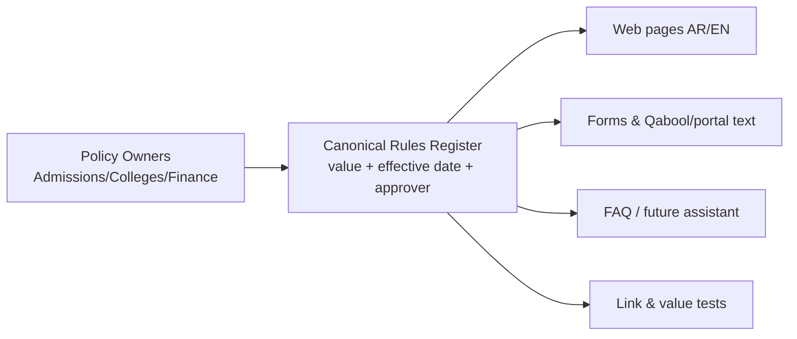

# PMU Admissions — تدقيق مستقل وخطة تنفيذية
**Independent Audit & Executive Project Plan** · تاريخ التحقق: **2026-10-10** · الوضع: قراءة فقط (Read-only)

> **القرار الحالي: FULL PROJECT CLOSURE — NOT MET** (خط الأساس المقاس عند التدقيق).
> لم يُنفَّذ أي تعديل على أنظمة الجامعة؛ لا توجد صلاحية نشر، ولا يحق لي حسم سياسات القبول.

---

## 1. الملخص التنفيذي

- **ما فُحص:** 29 مورداً عاماً من نطاق `pmu.edu.sa` (انظر الملحق أ)، مع تحقق خارجي من College Board وETS ووزارة التعليم (منصة قبول).
- **الحصيلة:** 15 ملاحظة موثقة: **4 High، 9 Medium، 2 Low**، إضافةً إلى **مواضع نجاح مقيسة** (القسم 4) و**4 ملاحظات سُحبت** (القسم 11).
- **أخطر ما ثبت:**
  1. صفحة الطلبة الدوليين تشترط **SAT II بوزن 30%** لتخصصات CS/Engineering، بينما أوقفت College Board اختبارات SAT Subject Tests عام 2021، وصفحة الطلبة المحليين لنفس التخصصات تعتمد معايير مختلفة كلياً (Qudrat/Tahseely).
  2. **رسوم التقديم متعارضة**: `SAR 500 (excl. VAT)` للتحويل والزائر (صفحة الدوليين) مقابل `SAR 950 (incl. VAT)` في صفحة الرسوم وصفحات التحويل والزائر المحلية؛ ورسوم الطب **SAR 1000** غائبة تماماً عن صفحة الرسوم الرسمية.
  3. **تقويم القبول** يعلن النتائج (19–21 يوليو 2026) **قبل** إغلاق موعد تسليم IELTS/TOEFL ووثائق التحويل (20 يوليو 2026)، وكل مواعيده منتهية اليوم (10 أكتوبر 2026) دون نافذة قادمة.
  4. صفحة التحويل القديمة تنشر حداً أدنى **IELTS 5.0 لكل مهارة** بينما تنشر بقية الصفحات **6.0 كلي و5.5 كتابة**.
- **السبب الجذري المرجَّح (لا المثبت):** غياب مصدر موحد ومحكوم للقواعد (Single Source of Truth) وغياب تاريخ نفاذ/مالك/دورة مراجعة، فتتراكم أجيال متعددة من المحتوى (وصفحة بتاريخ 2019 ما زالت متاحة).
- **العقبة الحرجة في المسار:** قرارات مؤسسية (من يملك قاعدة IELTS، الرسوم، SAT II) وليست تقنية.

---

## 2. حدود الوصول والأدوات (أمانة التغطية)

| الأداة/القدرة | الحالة | الأثر |
|---|---|---|
| WebFetch على pmu.edu.sa | **BLOCKED** — HTTP 403 | استُبدلت بأداة TinyFish fetch |
| TinyFish fetch/search | تعمل | نص الصفحات بلا روابط `href` |
| متصفح حقيقي / فحص DOM / موبايل / WCAG / Lighthouse | **BLOCKED** — رصيد TinyFish = 0 | **NOT TESTED**: وجهات أزرار Apply Now، overflow، `lang`، ترتيب العناوين، alt، الأداء |
| WebFetch إلى ets.org | **BLOCKED** — فشل DNS | تحقق ETS عبر ملخص بحث ثانوي → ثقة متوسطة |
| Gmail / Drive / سجلات سابقة | **لم تُفتح عمداً** | الاستقلالية عن النتائج السابقة؛ وفتحها يحتاج إذنك الصريح |
| صلاحية نشر/تعديل على موقع الجامعة | غير متوفرة | لا تصحيح فعلي؛ كل المعالجات = مقترحات |

لم يُرسل أي نموذج ولم يُسجَّل حساب ولم تُدفع رسوم.

---

## 3. خط الأساس: مصفوفة الحقيقة (Policy Truth Matrix) — المتعارضات

| القاعدة | الصفحة/القيمة المنشورة | الصفحة/القيمة المعارضة | الحكم |
|---|---|---|---|
| وزن CS/Eng | Intl: `Secondary School 40% / SAT I 30% / SAT II 30%` | Local: `HS GPA ≥85 (40%) / Qudrat ≥65 (30%) / Tahseely ≥65 (30%)` | Verified Conflict |
| رسوم التحويل | Intl: `SAR 500 (excl. VAT)` | Local + Fees: `SAR 950 (incl. VAT)` | Verified Conflict |
| رسوم الزائر | Intl: `SAR 500 (excl. VAT)` | Local: `SAR 950 (incl. VAT)` | Verified Conflict |
| رسوم الطب | Medicine + next-steps: `SAR 1000` | Fees: لا ذكر للطب (`Undergraduate: 950`) | Silent-page gap |
| IELTS للتحويل | `/transfer-student-admission`: `6.0 ... minimum score of 5.0 on each test component` | بقية الصفحات: `6.0 overall and 5.5 in writing` | Verified Conflict |
| الطب — الحد الأدنى | مكونات: `95%`, `80`, `80` | `20% HS + 40% Qudrat + 40% Tahseely ... 86 is the minimum` | حساب: 0.2×95+0.4×80+0.4×80 = **83 < 86** |
| التقويم | نتائج `From July 19 to July 21, 2026` | `Last day to submit IELTS or TOEFL iBT: 2026-07-20` | تناقض زمني |

## 4. ما ثبت سليماً (Measured Passes)

- رسوم 950 ريال (شاملة الضريبة) متسقة في: صفحة البكالوريوس، الرسوم، القبول المباشر، الإعداد، الدراسات العليا (MSHD)، MBA، التحويل المحلي.
- IELTS `6.0 / 5.5` متسق في 7+ صفحات؛ TOEFL `83 / 19` متسق في `/toefl-admission` و`/placement_undergraduate_program` و`/apply`.
- شرط الثانوية 80% وQudrat 60% وبديل الوزن 60/40 متسق في 3 صفحات.
- GPA التحويل 2.0 وآخر مقرر ≤ 5 سنوات متسق.
- **تكافؤ اللغتين** في `/apply` (IELTS/TOEFL/Home Edition) و`/next-steps` (950/1000، موعد السداد، موقع الاختبار): **متطابق**. (حد الادعاء: الموعد الهجري `24/01/1448هـ` لم أتحقق منه تقويمياً؛ والميلادي July 9, 2026 يوم خميس ✔.)
- Qabool (`uap.sa`) منصة وطنية رسمية تابعة لوزارة التعليم ✔ (مصدر خارجي).

---

## 5. سجل الملاحظات (Findings Register)

| ID | الخطورة | الملاحظة والدليل (حرفياً) | الأثر | المعالجة المقترحة |
|---|---|---|---|---|
| **F-01** | **High** | `international_students`: "Computer Science & Engineering Majors: Secondary School 40% / SAT I 30% / SAT II 30%". خارجياً: College Board أنهت SAT Subject Tests (إعلان 19 يناير 2021) | شرط لا يمكن استيفاؤه + تعارض مع الصفحة المحلية | قرار الكلية/القبول بمعيار بديل؛ إزالة SAT II |
| **F-02** | **High** | Intl: "Pay a non-refundable application fee of SAR 500 (excl. VAT)" (تحويل/زائر) مقابل "SAR 950 (incl. VAT)" في `student_fees_tf_ro` و`admission-from-other-universities` و`visiting-student-admission` | تعارض مالي؛ 500+15% = 575 | قرار المالية؛ جدول رسوم موحد |
| **F-03** | **High** | Fees: "Admission Application Fees- Undergraduate Programs … SAR 950". الطب: "SAR 1000 (incl. VAT)" و`next-steps`: "except for Medicine major (SAR 1000)" | رسم غائب عن المرجع الرسمي | إضافة صف الطب بعد اعتماد المالية |
| **F-04** | **High** | Calendar: "Announcement … From July 19 to July 21, 2026" و"Last day to submit IELTS or TOEFL iBT 2026-07-20" و"Last day for Transfer … 2026-07-20"؛ كل التواريخ ≤ 2026-08-30، واليوم 2026-10-10 | تقويم منتهٍ وغير متسق؛ لا نافذة قادمة | تقويم بأرقام فصول/نوافذ وتواريخ نفاذ |
| **F-05** | **Medium** | `/transfer-student-admission`: "minimum score of 5.0 on each test component" | حد أدنى معارض | تحديد المرجع؛ إعادة توجيه الصفحة القديمة |
| **F-06** | **Medium** | الطب: "(95%)", "(80)", "(80)" و"86 is the minimum" و"were 86" (خطأ لغوي) | الحدود الدنيا للمكونات لا تضمن الحد الكلي؛ غموض | توضيح من كلية الطب |
| **F-07** | **Medium** | "the minimum weighted total, defined by the Admissions Office, should be met" | الحد الكلي غير منشور | قرار بنشر أو شرح آلية المفاضلة |
| **F-08** | **Medium** | TOEFL منشور على مقياس 0–120 فقط (`83/19`). ETS: مقياس 1–6 بدءاً من 21 يناير 2026 (مصدر ثانوي) | غموض للمتقدمين بتقارير جديدة | جدول تكافؤ معتمد |
| **F-09** | **Medium** | `/ielts_course`: "From July 14, 2019 to August 02, 2019", "Recent High School graduate from academic year 2018/2019", رابط `IELTS-Register.aspx` | صفحة قديمة متاحة بسعر/تسجيل | Redirect/Noindex/Archive بعد فحص التبعيات |
| **F-10** | **Medium** | MBA (محلي): "83 overall and 19 in each skill"؛ MBA (دوليين): "or equivalent TOEFL iBT." بلا أرقام؛ البكالوريوس: "equivalent TOEFL iBT with acceptable scores" | الدرجة غير معرّفة في نقطة القرار | رابط/جدول موحد |
| **F-11** | **Medium** | فهرس الدراسات العليا: صفحة القبول تعرض EMGMS وMIBL، والصفحة الأخرى تعرض "MA … International Business Law" بلا EMGMS | اختلاف قائمة البرامج | كتالوج برامج واحد |
| **F-12** | **Medium** | `degrees_programs_fs_ro` أعادت 6 برامج أعمال فقط | قائمة برامج ناقصة أو معتمدة على JavaScript | **Unverified** — تحتاج متصفحاً |
| **F-13** | **Medium** | Aptis: "SAR 575" في الرسوم الاختيارية؛ صفحات القبول: "they will be scheduled to take Aptis test" بلا ذكر رسم | رسم محتمل غير ظاهر في صفحة القرار | توضيح من القبول |
| **F-14** | Low | أخطاء لغوية: "Visting Students", "wave one or more", "College of Medical", "prospectus students" | صورة مؤسسية | تدقيق لغوي |
| **F-15** | Low | `/news/2010/...` ("until the end of Ramadan") و`admission_from_preparatory_program_ads` ("Department of Interior Design", "College of CLES") | محتوى قديم قابل للاكتشاف | أرشفة/Noindex |

**غير مختبر:** مسارات Apply Now، تجربة الهاتف، WCAG 2.2 AA، الأداء، تكاملات الدفع/الإشعارات، روابط PDF، تطابق العربية في الصفحات الأساسية (لم أعثر على مسار عربي لصفحات القبول الأساسية؛ الصفحات المحصورة العربية: `/apply` و`/next-steps` فقط — لم يُختبر ذلك استقصائياً).

---

## 6. الحالة المستهدفة وSingle Source of Truth

الدليل يدعم افتراض الحاجة: نفس القاعدة منشورة يدوياً في 5–8 صفحات بأجيال مختلفة.

---

## 7. خطة المشروع التنفيذية (مستنتجة من الملاحظات)

**الهدف:** نشر قواعد قبول ورسوم ومواعيد صحيحة ومعتمدة وموحدة ثنائية اللغة، مع حوكمة تمنع التكرار.
**خارج النطاق:** قرارات القبول الفردية، نظام Banner، التسويق.
**المسارات:**
1. **WS1 قرارات السياسة** (IELTS، رسوم، SAT II/CS-Eng، الطب).
2. **WS2 تصحيح المحتوى** (بعد القرارات).
3. **WS3 دورة حياة الصفحات القديمة** (Replace → Redirect/Noindex → Verify → Archive → Retire).
4. **WS4 التقويم والفصول**.
5. **WS5 حوكمة وSSOT**.
6. **WS6 اختبار شامل** (متصفح، موبايل، WCAG، لغتان).

```mermaid
gantt
dateFormat X
axisFormat %s
section Critical path
قرارات D-01..D-06 :crit, 0, 3
تصحيح المحتوى :3, 2
اختبار + UAT :5, 2
نشر وتحقق :7, 1
section موازي
فحص المتصفح/الوصول :0, 3
جرد الصفحات القديمة :0, 2
SSOT وحوكمة :4, 4
```

*الوحدات ترتيبية فقط؛ لا تواريخ مختلقة. القيد الصلب: أن يُنشر التقويم قبل فتح نافذة التقديم القادمة (يتحدد من وزارة التعليم/الجامعة).*

**الأدوار (وظائف لا أسماء):** Admissions Office، Registration، Colleges، Finance، Web Administration، IT، Quality، Legal/Compliance، Executive Sponsor.

---

## 8. القرارات المطلوبة (Decision Register)

| ID | القرار | الجهة | يعتمد عليه | أولوية |
|---|---|---|---|---|
| D-01 | قيمة IELTS للتحويل: 5.0 لكل مهارة أم 5.5 كتابة؟ | Admissions + Registration | F-05، إلغاء الصفحة القديمة | P1 |
| D-02 | رسوم التحويل/الزائر للدوليين وطريقة الضريبة | Finance | F-02 | P1 |
| D-03 | رسوم الطب: إدراجها في الرسوم الرسمية | Finance + Medicine | F-03 | P1 |
| D-04 | معيار CS/Eng للدوليين بعد توقف SAT II | Colleges + Admissions | F-01 | P1 |
| D-05 | نشر الحد الكلي للمفاضلة أم لا | Executive Sponsor | F-07 | P2 |
| D-06 | جدول تكافؤ TOEFL (0–120/1–6) | Admissions + Testing Center | F-08 | P2 |
| D-07 | مصير `/ielts_course` والصفحات القديمة | Web Admin + Admissions | F-09، F-15 | P2 |
| D-08 | هل الطب يحتاج SAT 1300 كما هو منشور؟ والحد الكلي 86 | College of Medicine | F-06 | P1 |

---

## 9. محفظة الفرص الاستراتيجية (حكم تحليلي؛ ثقة منخفضة–متوسطة)

الأوزان: الأثر 30 / المخاطر 25 / التشغيلي 20 / الجاهزية 15 / السرعة 10؛ الدرجات 1–5 تقدير المدقق وليست بيانات.

| المبادرة | الدرجة | التصنيف |
|---|---|---|
| Single Source of Truth + Policy Register | **4.30** | Closure-Critical (جزء) |
| حوكمة التقويم والفصول | **4.05** | Closure-Critical |
| مراقبة المعايير الخارجية (SAT/TOEFL/IELTS/Aptis) | 3.85 | Approved Implementation |
| دورة حياة الصفحات القديمة | 3.30 | Approved Implementation |
| تكافؤ اللغتين | 3.25 | Management Decision |
| قياس مسار المتقدم (Funnel Analytics) | 3.15 | Roadmap — **لا خط أساس موجود** |
| أداة أهلية استرشادية | 2.70 | Roadmap، تعتمد على SSOT |
| مساعد ذكي مضبوط | 2.40 | Roadmap، بعد SSOT |

لا أرقام مالية أو نسب تحسين متوقعة؛ لا توجد بيانات.

---

## 10. مؤشرات الأداء وبوابات الإغلاق

| KPI | خط الأساس (من التدقيق) | الهدف |
|---|---|---|
| قواعد متعارضة منشورة | 5 تعارضات مثبتة (F-01,02,05,06,04) | 0 |
| صفحات قديمة متاحة دون Redirect/Noindex | ≥ 3 مكتشفة | 0 |
| تقويم بنافذة قادمة صالحة | لا | نعم |
| قيم رسوم متعارضة | 2 مجموعات | 0 |
| اختبارات الموبايل/WCAG/CTA | غير مختبرة | منفذة وموثقة |

| البوابة | الحالة |
|---|---|
| G0 Access & Scope | **PARTIAL** — متصفح محجوب |
| G1 Evidence | **PARTIAL** — 29 مورداً، بلا لقطات |
| G2 Policy Validation | **FAIL** — تعارضات مفتوحة |
| G3 Remediation | NOT STARTED — لا صلاحية/قرارات |
| G4 QA/UAT | NOT TESTED |
| G5 Production Verification | NOT TESTED |
| G6 Governance & Handover | NOT STARTED |
| G7 Executive Closure | NOT MET |

**الحكم: FULL PROJECT CLOSURE — NOT MET.**

---

## 11. التصحيح الذاتي (Withdrawn / Corrected)

1. **سُحب:** احتمال تعارض الموعد الهجري `24/01/1448هـ` مع July 9 — الميلادي خميس صحيح؛ لم أتحقق هجرياً، فلا ادعاء.
2. **سُحب:** "صفحة الإعداد بلا شروط قبول" — خلل استخراج؛ مقتطف البحث يثبت وجودها.
3. **سُحب:** ربط 500+VAT=575 برسم Aptis 575 — مصادفة رقمية لا دليل عليها.
4. **سُحب:** عدّ 85/65/65 مقابل 80/60 تعارضاً — فئتان متدرجتان بالتصميم.
- **تحذير ثقة:** ملاحظة TOEFL 1–6 مبنية على ملخص بحث ثانوي (ETS DNS محجوب)؛ وتلميح "تقويم 2024-2025" في الصفحة الرئيسية من مقتطف بحث فقط (غير محقق مباشرة، لم أدرجه ملاحظة).

---

## 12. الملحق أ — سجل التغطية (Crawl Coverage)

**Reviewed (29):** admission/admission · undergraduate_programs_admission · international_students · admission_calendar_fs_ro · student_fees_tf_ro · apply · next-steps/ · direct-admissions-from-secondary-school · transfer-student-admission · admission-from-other-universities · admission-to-the-preparatory-program · visiting-student-admission · coe-admission-requirements · placement_undergraduate_program · overview-undergraduate-placement-tests · ielts-admission · toefl-admission · aptis-placement-test · ielts_course · admissions_requirements_cs_eng_majors · college_of_medicine_admission · admission_from_preparatory_program_ads · degrees_programs_fs_ro · admissions_requirements_mba_gdp · application_form_msehd_gdp · mba_international_students · admission_graduate_degree_programs · news/2010/…/index · homepage.

**Identified, not fetched:** admission_contact_gdp، admissions_requirements_emba_gdp، application_form_emba_gdp، admissions_queries، news?ID=1115، صفحات PhD/MSME/MSEE/MSCE/MSID/MIBL، Aptis candidate guide (PDF)، صفحة Web Admission Guide، Tuition (البرامج)، `studyinsaudi.sa`، `IELTS-Register.aspx`.

## 13. مصادر التحقق الخارجي
- [College Board ends SAT Subject Tests (ملخصات متعددة)](https://en.wikipedia.org/wiki/SAT_Subject_Tests)
- [ETS — TOEFL iBT score scale update](https://toeflaccess.ets.org/help/en/articles/11758616-toefl-ibt-score-scale-update-what-you-need-to-know) (لم يُفتح مباشرة)
- [وزارة التعليم — Unified Admission](https://www.moe.gov.sa/en/knowledgecenter/eservices/pages/unified-admission.aspx)
