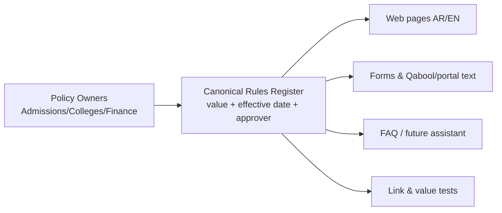

# PMU Admissions — تدقيق مستقل وخطة تنفيذية
**Independent Audit & Executive Project Plan** · تاريخ التحقق: **2026-10-10** · الوضع: قراءة فقط (Read-only)

> **القرار الحالي: NOT READY FOR CLOSURE** (توجد ملاحظات عالية مثبتة مانعة للإغلاق). وللعناصر غير المفحوصة: **INSUFFICIENT ACCESS OR EVIDENCE** — لا تُحتسب نجاحاً ولا فشلاً.
> الإصدار: v3 (2026-10-10) — أُضيف فحص متصفح فعلي (Chromium/Playwright، محاكاة موبايل).
> لم يُنفَّذ أي تعديل على أنظمة الجامعة؛ لا توجد صلاحية نشر، ولا يحق لي حسم سياسات القبول.

---

## 1. الملخص التنفيذي

- **ما فُحص:** 47 مورداً عاماً من نطاق `pmu.edu.sa` (انظر الملحق أ)، مع تحقق خارجي من College Board وETS ووزارة التعليم (منصة قبول).
- **الحصيلة:** 25 ملاحظة موثقة: **6 High، 14 Medium، 5 Low** (تصحيح: عدّ v2 كان 17 وصوابه 16 بعد سحب F-12)، إضافةً إلى **مواضع نجاح مقيسة** (القسم 4) و**8 استنتاجات سُحبت أو صُحِّحت** (القسم 11).
- **أخطر ما ثبت:**
  1. صفحة الطلبة الدوليين تشترط **SAT II بوزن 30%** لتخصصات CS/Engineering، بينما أوقفت College Board اختبارات SAT Subject Tests عام 2021، وصفحة الطلبة المحليين لنفس التخصصات تعتمد معايير مختلفة كلياً (Qudrat/Tahseely).
  2. **رسوم التقديم متعارضة**: `SAR 500 (excl. VAT)` للتحويل والزائر (صفحة الدوليين) مقابل `SAR 950 (incl. VAT)` في صفحة الرسوم وصفحات التحويل والزائر المحلية؛ ورسوم الطب **SAR 1000** غائبة تماماً عن صفحة الرسوم الرسمية.
  3. **تقويم القبول** يعلن النتائج (19–21 يوليو 2026) **قبل** إغلاق موعد تسليم IELTS/TOEFL ووثائق التحويل (20 يوليو 2026)، وكل مواعيده منتهية اليوم (10 أكتوبر 2026) دون نافذة قادمة.
  4. صفحة التحويل القديمة تنشر حداً أدنى **IELTS 5.0 لكل مهارة** بينما تنشر بقية الصفحات **6.0 كلي و5.5 كتابة**.
  5. **صفحة EMGMS تحتوي سياسة منسوخة من جامعة أخرى**: تشترط "Graduate English Language Endorsement from UA Center for English as Second Language (CESL)" وIELTS 7 وTOEFL 79 — وهي مطابقة لشروط University of Arizona المنشورة، لا لشروط PMU.
  6. **صفحة `freshman_admission` القديمة** ما زالت متاحة بأوزان `High school 30% / Aptitude Test 50% / Personal Interview 20%` وإعفاء `TOEFL 513 (CBT 183, iBT 65)` أو `IELTS 5.5`، وكلها تعارض الصفحات الحالية.
- **السبب الجذري المرجَّح (لا المثبت):** غياب مصدر موحد ومحكوم للقواعد (Single Source of Truth) وغياب تاريخ نفاذ/مالك/دورة مراجعة، فتتراكم أجيال متعددة من المحتوى (وصفحة بتاريخ 2019 ما زالت متاحة).
- **العقبة الحرجة في المسار:** قرارات مؤسسية (من يملك قاعدة IELTS، الرسوم، SAT II) وليست تقنية.

---

## 2. حدود الوصول والأدوات (أمانة التغطية)

| الأداة/القدرة | الحالة | الأثر |
|---|---|---|
| WebFetch على pmu.edu.sa | **BLOCKED** — HTTP 403 | استُبدلت بأداة TinyFish fetch |
| TinyFish fetch/search | تعمل | نص الصفحات بلا روابط `href` |
| TinyFish browser | **BLOCKED** — رصيد صفر | استُبدل بـ Chromium/Playwright المحلي |
| Chromium محاكاة موبايل (390px) | **يعمل** — قراءة فقط، GET وتنقل فقط، بلا نقر على نماذج/تقديم | قياسات §5ب |
| Chromium سطح المكتب (UA الافتراضي Headless) | **BLOCKED** — HTTP 403 | لم أتحايل على الحظر (لا تغيير UA لسطح المكتب)؛ **NOT TESTED** |
| Lighthouse / قارئ شاشة / لوحة مفاتيح / تباين / أداء | غير مثبّتة/لم تُنفَّذ | **NOT TESTED** |
| WebFetch إلى ets.org | **BLOCKED** — فشل DNS | تحقق ETS عبر ملخص بحث ثانوي → ثقة متوسطة |
| Gmail / Drive / سجلات سابقة | **لم تُفتح عمداً** | الاستقلالية عن النتائج السابقة؛ وفتحها يحتاج إذنك الصريح |
| صلاحية نشر/تعديل على موقع الجامعة | غير متوفرة | لا تصحيح فعلي؛ كل المعالجات = مقترحات |

لم يُرسل أي نموذج ولم يُسجَّل حساب ولم تُدفع رسوم.

---

## 3. خط الأساس: مصفوفة الحقيقة (Policy Truth Matrix) — المتعارضات

| القاعدة | الصفحة/القيمة المنشورة | الصفحة/القيمة المعارضة | الحكم |
|---|---|---|---|
| وزن CS/Eng | Intl: `Secondary School 40% / SAT I 30% / SAT II 30%` | Local: `HS GPA ≥85 (40%) / Qudrat ≥65 (30%) / Tahseely ≥65 (30%)` | Verified Conflict |
| رسوم التحويل | Intl: `SAR 500 (excl. VAT)` | Local + Fees: `SAR 950 (incl. VAT)` | Verified Conflict |
| رسوم الزائر | Intl: `SAR 500 (excl. VAT)` | Local: `SAR 950 (incl. VAT)` | Verified Conflict |
| رسوم الطب | Medicine + next-steps: `SAR 1000` | Fees: لا ذكر للطب (`Undergraduate: 950`) | Silent-page gap |
| IELTS للتحويل | `/transfer-student-admission`: `6.0 ... minimum score of 5.0 on each test component` | بقية الصفحات: `6.0 overall and 5.5 in writing` | Verified Conflict |
| الطب — الحد الأدنى | مكونات: `95%`, `80`, `80` | `20% HS + 40% Qudrat + 40% Tahseely ... 86 is the minimum` | حساب: 0.2×95+0.4×80+0.4×80 = **83 < 86** |
| التقويم | نتائج `From July 19 to July 21, 2026` | `Last day to submit IELTS or TOEFL iBT: 2026-07-20` | تناقض زمني |

## 4. ما ثبت سليماً (Measured Passes)

- رسوم 950 ريال (شاملة الضريبة) متسقة في: صفحة البكالوريوس، الرسوم، القبول المباشر، الإعداد، الدراسات العليا (MSHD)، MBA، التحويل المحلي.
- IELTS `6.0 / 5.5` متسق في 7+ صفحات؛ TOEFL `83 / 19` متسق في `/toefl-admission` و`/placement_undergraduate_program` و`/apply`.
- شرط الثانوية 80% وQudrat 60% وبديل الوزن 60/40 متسق في 3 صفحات.
- GPA التحويل 2.0 وآخر مقرر ≤ 5 سنوات متسق.
- **تكافؤ النص** بين العربية والإنجليزية داخل `/next-steps` (950/1000، موعد السداد، موقع الاختبار): **متطابق**. (**تصحيح v3:** نص `/apply` الثنائي اللغة موجود في HTML الثابت لكن المستخدم يُحوَّل عنه إلى البوابة، فلا يُعدّ نجاحاً في الرحلة — انظر F-23.) (حد الادعاء: الموعد الهجري `24/01/1448هـ` لم أتحقق منه تقويمياً؛ والميلادي July 9, 2026 يوم خميس ✔.)
- Qabool (`uap.sa`) منصة وطنية رسمية تابعة لوزارة التعليم ✔ (مصدر خارجي).

---

## 5. سجل الملاحظات (Findings Register)

| ID | الخطورة | الملاحظة والدليل (حرفياً) | الأثر | المعالجة المقترحة |
|---|---|---|---|---|
| **F-01** | **High** | `international_students`: "Computer Science & Engineering Majors: Secondary School 40% / SAT I 30% / SAT II 30%". خارجياً: College Board أنهت SAT Subject Tests (إعلان 19 يناير 2021) | شرط لا يمكن استيفاؤه + تعارض مع الصفحة المحلية | قرار الكلية/القبول بمعيار بديل؛ إزالة SAT II |
| **F-02** | **High** | Intl: "Pay a non-refundable application fee of SAR 500 (excl. VAT)" (تحويل/زائر) مقابل "SAR 950 (incl. VAT)" في `student_fees_tf_ro` و`admission-from-other-universities` و`visiting-student-admission` | تعارض مالي؛ 500+15% = 575 | قرار المالية؛ جدول رسوم موحد |
| **F-03** | **High** | Fees: "Admission Application Fees- Undergraduate Programs … SAR 950". الطب: "SAR 1000 (incl. VAT)" و`next-steps`: "except for Medicine major (SAR 1000)" | رسم غائب عن المرجع الرسمي | إضافة صف الطب بعد اعتماد المالية |
| **F-04** | **High** | Calendar: "Announcement … From July 19 to July 21, 2026" و"Last day to submit IELTS or TOEFL iBT 2026-07-20" و"Last day for Transfer … 2026-07-20"؛ كل التواريخ ≤ 2026-08-30، واليوم 2026-10-10 | تقويم منتهٍ وغير متسق؛ لا نافذة قادمة | تقويم بأرقام فصول/نوافذ وتواريخ نفاذ |
| **F-05** | **Medium** | `/transfer-student-admission`: "minimum score of 5.0 on each test component" | حد أدنى معارض | تحديد المرجع؛ إعادة توجيه الصفحة القديمة |
| **F-06** | **Medium** | الطب: "(95%)", "(80)", "(80)" و"86 is the minimum" و"were 86" (خطأ لغوي) | الحدود الدنيا للمكونات لا تضمن الحد الكلي؛ غموض | توضيح من كلية الطب |
| **F-07** | **Medium** | "the minimum weighted total, defined by the Admissions Office, should be met" | الحد الكلي غير منشور | قرار بنشر أو شرح آلية المفاضلة |
| **F-08** | **Medium** | TOEFL منشور على مقياس 0–120 فقط (`83/19`). ETS: مقياس 1–6 بدءاً من 21 يناير 2026 (مصدر ثانوي) | غموض للمتقدمين بتقارير جديدة | جدول تكافؤ معتمد |
| **F-09** | **Medium** | `/ielts_course`: "From July 14, 2019 to August 02, 2019", "Recent High School graduate from academic year 2018/2019", رابط `IELTS-Register.aspx` | صفحة قديمة متاحة بسعر/تسجيل | Redirect/Noindex/Archive بعد فحص التبعيات |
| **F-10** | **Medium** | MBA (محلي): "83 overall and 19 in each skill"؛ MBA (دوليين): "or equivalent TOEFL iBT." بلا أرقام؛ البكالوريوس: "equivalent TOEFL iBT with acceptable scores" | الدرجة غير معرّفة في نقطة القرار | رابط/جدول موحد |
| **F-11** | **Medium** | ثلاث قوائم دراسات عليا مختلفة: صفحة القبول (PhD-ME, PhD-BA, EMBA, MBA, MSHD, MSME, MSEE, MSCE, MSID, EMGMS, MIBL)، وصفحة الدراسات العليا (بلا EMGMS)، وقائمة الاتصال (EMBA, MBA, MSEHD فقط). وتسمية MSHD/MSEHD/MSDH لبرنامج واحد | اختلاف قائمة البرامج | كتالوج برامج واحد |
| ~~F-12~~ | — | سُحبت: أعاد الجلب 6 صفوف لصفحة `degrees_programs_fs_ro` بينما يعرض فهرس البحث لنفس الرابط صفوف كلية القانون (MIBL)؛ أي أن الاستخراج جزئي لا أن الصفحة معيبة | — | **Withdrawn / NOT TESTED** (يحتاج متصفحاً) |
| **F-13** | **Medium** | Aptis: "SAR 575" في الرسوم الاختيارية؛ صفحات القبول: "they will be scheduled to take Aptis test" بلا ذكر رسم | رسم محتمل غير ظاهر في صفحة القرار | توضيح من القبول |
| **F-16** | **High** | `admissions_requirements_emgms_gdp`: "Graduate English Language Endorsement from UA Center for English as Second Language (CESL)"، "IELTS – minimum composite score of 7, with no subject area below a 6"، "TOEFL – minimum of 79 iBT (or 60 on the revised PBT …)"، "Pearson PTE Academic – minimum of 60". خارجياً: الشروط نفسها منشورة لـ University of Arizona وCESL (endorsement صالح لجامعة أريزونا فقط) | سياسة جامعة أخرى منشورة كشرط PMU؛ تضلّل المتقدم وتعارض 6.0/5.5 في بقية الدراسات العليا | قرار كلية الهندسة/الدراسات العليا بالشروط الفعلية؛ استبدال النص |
| **F-17** | **High** | `freshman_admission`: "High school 30% / Aptitude Test 50% / Personal Interview 20%"؛ "TOEFL score of 513 (CBT 183, iBT 65) or more, or with an IELTS Band of 5.5 or more … will be exempted from the placement test"؛ "National Center for Testing and Evaluation". خارجياً: TOEFL CBT توقف بعد سبتمبر 2006؛ والمركز يُعرف اليوم بـ Qiyas التابع لـ ETEC | أوزان وإعفاء وأسماء قديمة تعارض 60/40 و6.0/5.5 و83/19 | Redirect/Noindex بعد فحص التبعيات؛ قرار القبول بالمرجع |
| **F-14** | Low | أخطاء لغوية: "Visting Students", "wave one or more", "College of Medical", "prospectus students" | صورة مؤسسية | تدقيق لغوي |
| **F-15** | Low | `/news/2010/...` ("until the end of Ramadan")، و`news?ID=1115` ("العام الجامعي 1436/1435هـ")، و`admission_from_preparatory_program_ads` ("Department of Interior Design", "College of CLES") | محتوى قديم قابل للاكتشاف | أرشفة/Noindex |

**غير موثق كمخالفة (Unverified):** صفحة MIBL تعرض عناوين "Educational Background" و"English Language Proficiency Test" فارغة، ونموذج MIBL أعاد جملة واحدة فقط — قد يكون خللَ استخراج؛ تحتاج متصفحاً.

**غير مختبر (بعد v3):** تجربة سطح المكتب، لوحة المفاتيح وقارئ الشاشة والتباين، الأداء، تكاملات الدفع/الإشعارات، روابط PDF، مسار التسجيل داخل البوابة (لم أعثر على مسار عربي لصفحات القبول الأساسية؛ الصفحات المحصورة العربية: `/apply` و`/next-steps` فقط — لم يُختبر ذلك استقصائياً).

---

## 5ب. فحص المتصفح الفعلي (Browser Assurance) — 2026-10-10

**الطريقة:** Chromium 1194 عبر Playwright، محاكاة iPhone 390×844، تحميل الصفحات وانتظار `networkidle`، قياسات DOM، تتبع إعادة التوجيه، وطلبات GET لحالة الروابط. **لم يُنقر زر تقديم ولا نموذج ولا تسجيل.** السكربتات والنتائج الخام: `evidence/browser/`.
**حد الادعاء:** 14 صفحة مُقاسة بالتفصيل + 84 رابطاً داخلياً؛ هذا ليس تدقيق WCAG كاملاً.

### نتائج الاختبارات
| Test | الاختبار | النتيجة |
|---|---|---|
| BT-01 | عدم وجود تمرير أفقي على 390px | **PASS** 13/14 · **FAIL** `next-steps` (scrollWidth 440 > 390، مصدره قائمة التنقل) |
| BT-02 | `meta viewport` | **PASS** (الصفحتان المقاستان تفصيلاً) |
| BT-03 | `html[lang]` | **FAIL** 13/14 صفحة `www.pmu.edu.sa` (القيمة فارغة)؛ **PASS** `admissions.pmu.edu.sa` (`en`) |
| BT-04 | `alt` للصور | **FAIL**: 4 من 6 صور بلا `alt` في معظم الصفحات؛ 5 من 7 في صفحة البكالوريوس؛ 5 من 22 في الرئيسية |
| BT-05 | ترتيب العناوين | **FAIL** جزئي: `H2` قبل `H1` في صفحات متعددة؛ البكالوريوس: `H1→H3→H4` ثم `H3`؛ الدوليين: `H2→H4` |
| BT-06 | وجهات أزرار التقديم (7 صيغ URL) | **PASS**: كلها تنتهي إلى `https://admissions.pmu.edu.sa/welcome` |
| BT-07 | حالة الروابط الداخلية (84 رابطاً فريداً) | **PASS** بعد إعادة اختبار 3 مهلات عابرة (200). 68 رابطاً قديماً `.aspx` يُعاد توجيهه لنسخة بلا امتداد |
| BT-08 | `meta description` / `canonical` | **FAIL**: غائبان في 14/14 صفحة |
| BT-09 | مبدّل لغة عربي/إنجليزي | **Observed absent**: لم يُعثر على مبدّل في 14 صفحة (فحص استدلالي على نص الروابط) |
| BT-10 | سطح المكتب، لوحة المفاتيح، قارئ الشاشة، التباين، الأداء، Core Web Vitals | **NOT TESTED / BLOCKED** |
| BT-11 | بوابة التقديم والنماذج والدفع | **NOT TESTED** (إجراءات مقيَّدة، تحتاج بيئة اختبار مصرحاً بها) |

### ملاحظات جديدة مثبتة بالمتصفح
| ID | الخطورة | الدليل | الأثر |
|---|---|---|---|
| **F-18** | Medium | `document.documentElement.lang === ""` في 13 صفحة؛ وصفحة `next-steps` ثنائية اللغة بلا إعلان لغة | تعذر نطق القارئ للغة الصحيحة؛ WCAG 3.1.1/3.1.2 |
| **F-19** | Medium | صور بلا خاصية `alt` (4/6، 5/7، 5/22) | WCAG 1.1.1 |
| **F-20** | Low | لا `meta description` ولا `canonical` في 14 صفحة؛ روابط داخلية بصيغ `.aspx`/حالات أحرف/مضيفين `pmu.edu.sa` و`www.pmu.edu.sa` | تكرار URL وضعف الفهرسة |
| **F-21** | Medium | `next-steps` على 390px: `scrollWidth=440`؛ العناصر: `NAV` و`ul.dropdown` | صفحة سداد الرسوم وتعليمات الاختبار صعبة على الهاتف |
| **F-22** | Medium | بوابة `admissions.pmu.edu.sa/welcome`: "Admission Calendar — No events are currently published. Please check back later." بينما موقع الجامعة ينشر تواريخ؛ وتذييلات "2021 ©" و"2022 ©" | مرجعا تقويم متعارضان؛ تذييل قديم |
| **F-23** | Medium | HTML الثابت لـ `/apply` يحوي نصاً ثنائي اللغة (IELTS/TOEFL/Home Edition)، لكن المتصفح يُحوَّل فوراً إلى بوابة لا تعرض أي متطلبات ولا مبدّل لغة | النص العربي المنشور غير متاح لمستخدم عادي؛ **يسحب ادعاء "تكافؤ اللغتين" السابق** |
| **F-24** | Low | زرا Apply Now في صفحة التقويم بصيغة `javascript:WebForm_DoPostBackWithOptions(... "https://pmu.edu.sa/admission/Apply_Now_ADS" ...)` | يفشل بلا JavaScript؛ 7 صيغ URL لنفس الوجهة |
| **F-25** | Medium | قائمة البرامج المُصيَّرة (10 جداول، `degrees_programs_fs_ro`) **لا تتضمن EMGMS ولا الطب**؛ وتتضمن Chemical Engineering وAI وCybersecurity وIT وGraphic Design بينما صفحة CS/Eng المحلية تحصر التخصصات في Architecture وCS وCE وSE وME وEE وCivil | برنامج بصفحة قبول غير مدرج في الكتالوج؛ قاعدة تخصصات ناقصة | 
| **F-26** | Low | ترتيب العناوين (BT-05) | WCAG 1.3.1 |

**ما سلم:** عدم وجود تمرير أفقي في 13/14 صفحة، `viewport` سليم، 84/84 رابطاً داخلياً يعطي 200 بعد إعادة التوجيه، وكل مسارات "Apply" تصل لوجهة واحدة. صفحة المساعدات الفرعية للرسوم (`fees_tf_ro`) تعرض روابط لـ "Intake 2026/2027" وMedical Program Studies؛ **لم تُقرأ أرقام الرسوم بعد** (محتواها في صفحات فرعية).

**المساعد الرقمي:** الصفحة الرئيسية تحوي عنوان "PMUer Virtual Assistant" وقسم "الأسئلة الشائعة" — أي أن مبادرة المساعد/مركز المعرفة **ليست جديدة**؛ وظيفتهما وضوابطهما **NOT TESTED**.

---

## 6. الحالة المستهدفة وSingle Source of Truth

الدليل يدعم افتراض الحاجة: نفس القاعدة منشورة يدوياً في 5–8 صفحات بأجيال مختلفة.

---

## 7. خطة المشروع التنفيذية (مستنتجة من الملاحظات)

**الهدف:** نشر قواعد قبول ورسوم ومواعيد صحيحة ومعتمدة وموحدة ثنائية اللغة، مع حوكمة تمنع التكرار.
**خارج النطاق:** قرارات القبول الفردية، نظام Banner، التسويق.
**المسارات:**
1. **WS1 قرارات السياسة** (IELTS، رسوم، SAT II/CS-Eng، الطب).
2. **WS2 تصحيح المحتوى** (بعد القرارات).
3. **WS3 دورة حياة الصفحات القديمة** (Replace → Redirect/Noindex → Verify → Archive → Retire).
4. **WS4 التقويم والفصول**.
5. **WS5 حوكمة وSSOT**.
6. **WS6 اختبار شامل** (متصفح، موبايل، WCAG، لغتان).

```mermaid
gantt
dateFormat X
axisFormat %s
section Critical path
قرارات D-01..D-06 :crit, 0, 3
تصحيح المحتوى :3, 2
اختبار + UAT :5, 2
نشر وتحقق :7, 1
section موازي
فحص المتصفح/الوصول :0, 3
جرد الصفحات القديمة :0, 2
SSOT وحوكمة :4, 4
```

*الوحدات ترتيبية فقط؛ لا تواريخ مختلقة. القيد الصلب: أن يُنشر التقويم قبل فتح نافذة التقديم القادمة (يتحدد من وزارة التعليم/الجامعة).*

**الأدوار (وظائف لا أسماء):** Admissions Office، Registration، Colleges، Finance، Web Administration، IT، Quality، Legal/Compliance، Executive Sponsor.

---

## 8. القرارات المطلوبة (Decision Register)

| ID | القرار | الجهة | يعتمد عليه | أولوية |
|---|---|---|---|---|
| D-01 | قيمة IELTS للتحويل: 5.0 لكل مهارة أم 5.5 كتابة؟ | Admissions + Registration | F-05، إلغاء الصفحة القديمة | P1 |
| D-02 | رسوم التحويل/الزائر للدوليين وطريقة الضريبة | Finance | F-02 | P1 |
| D-03 | رسوم الطب: إدراجها في الرسوم الرسمية | Finance + Medicine | F-03 | P1 |
| D-04 | معيار CS/Eng للدوليين بعد توقف SAT II | Colleges + Admissions | F-01 | P1 |
| D-05 | نشر الحد الكلي للمفاضلة أم لا | Executive Sponsor | F-07 | P2 |
| D-06 | جدول تكافؤ TOEFL (0–120/1–6) | Admissions + Testing Center | F-08 | P2 |
| D-07 | مصير `/ielts_course` والصفحات القديمة | Web Admin + Admissions | F-09، F-15 | P2 |
| D-09 | شروط اللغة الفعلية لـ EMGMS (واستبدال نص جامعة أريزونا) | College of Engineering + Graduate Admissions | F-16 | P1 |
| D-10 | إيقاف `freshman_admission` والمرجع الوحيد لأوزان المفاضلة | Admissions + Registration | F-17 | P1 |
| D-08 | هل الطب يحتاج SAT 1300 كما هو منشور؟ والحد الكلي 86 | College of Medicine | F-06 | P1 |

---

## 9. محفظة الفرص الاستراتيجية (حكم تحليلي؛ ثقة منخفضة–متوسطة)

الأوزان: الأثر 30 / المخاطر 25 / التشغيلي 20 / الجاهزية 15 / السرعة 10؛ الدرجات 1–5 تقدير المدقق وليست بيانات.

| المبادرة | الدرجة | التصنيف |
|---|---|---|
| Single Source of Truth + Policy Register | **4.30** | Closure-Critical (جزء) |
| حوكمة التقويم والفصول | **4.05** | Closure-Critical |
| مراقبة المعايير الخارجية (SAT/TOEFL/IELTS/Aptis) | 3.85 | Approved Implementation |
| دورة حياة الصفحات القديمة | 3.30 | Approved Implementation |
| تكافؤ اللغتين | 3.25 | Management Decision |
| قياس مسار المتقدم (Funnel Analytics) | 3.15 | Roadmap — **لا خط أساس موجود** |
| أداة أهلية استرشادية | 2.70 | Roadmap، تعتمد على SSOT |
| مساعد ذكي مضبوط | 2.40 | Roadmap، بعد SSOT |

لا أرقام مالية أو نسب تحسين متوقعة؛ لا توجد بيانات.

---

## 10. مؤشرات الأداء وبوابات الإغلاق

| KPI | خط الأساس (من التدقيق) | الهدف |
|---|---|---|
| قواعد متعارضة منشورة | ≥ 8 تعارضات مثبتة (F-01,02,04,05,06,16,17 + F-03 غياب) | 0 |
| صفحات قديمة متاحة دون Redirect/Noindex | ≥ 5 مكتشفة (F-09,F-15,F-17,F-05 + أخبار 1436هـ) | 0 |
| تقويم بنافذة قادمة صالحة | لا | نعم |
| قيم رسوم متعارضة | 2 مجموعات | 0 |
| صفحات بلا `lang` | 13/14 | 0 |
| صور بلا alt (الصفحات المقاسة) | 4–5 لكل صفحة | 0 |
| صفحات بتمرير أفقي على الموبايل | 1/14 | 0 |
| مرجعا تقويم متعارضان | نعم (موقع مقابل بوابة) | تقويم واحد |
| اختبارات الموبايل/WCAG/CTA | غير مختبرة | منفذة وموثقة |

| البوابة | الحالة |
|---|---|
| G0 Authority & Scope | **PARTIAL** — لا صلاحية نشر؛ النطاق مكتشف جزئياً |
| G1 Coverage & Evidence | **PARTIAL** — 57.3% محتوى، 17.1% قياسات متصفح، لقطتا شاشة موبايل + JSON خام |
| G2 Policies & Decisions | **FAIL** — 8 قرارات P1/P2 مفتوحة |
| G3 Critical Remediation | **NOT STARTED** |
| G4 QA & UAT | **PARTIAL** — 9 اختبارات متصفح منفَّذة (BT-01..09؛ BT-10 وBT-11 غير منفَّذين)، UAT غير منفَّذ |
| G5 Production Changes | **NOT APPLICABLE بعد** (لا تغييرات) |
| G6 Security/Privacy/Compliance | **NOT TESTED** |
| G7 Continuity & Rollback | **NOT TESTED** |
| G8 Governance & Handover | **NOT STARTED** |
| G9 Strategic Portfolio | **DELIVERED (مسودة)** — §9 و10ج |
| G10 Independent Closure Audit | **NOT MET** |
| G11 Formal Approval | **NOT OBTAINED** |

**الحكم: NOT READY FOR CLOSURE.** (ما لم يُفحص يبقى INSUFFICIENT ACCESS OR EVIDENCE.)

## 10أ. حساب التغطية (Coverage Mathematics)

**التعريف:** المقام = عناصر PMU الداخلية المحددة داخل النطاق والمكتشفة حتى الآن (حد أدنى؛ لا يشمل ما لم يُكتشف). البسط = عناصر جُلب محتواها فعلياً.
- المقام: **82** (47 مجلوبة + 35 غير مجلوبة: 10 صفحات دراسات عليا [متطلبات MSEHD، PhD-BA×2، متطلبات PhD-ME، نموذج MSEE، MSCE×2، MSID req، نموذج EMGMS، نموذج MSID لم يُقرأ نصه]، 2 أدلة، 13 مساعدات مالية، 2 رسوم دراسية، 8 صفحات رسوم فرعية [Medical Program Studies، Intake 2026/2027، Intake 2025/2026، Continuing 2024-2025، Post Graduate Fees، Payment FAQ، Summer، Payment Schedule]).
- **Audit Coverage (محتوى مجلوب) = 47 / 82 = 57.3%**
- **Audit Coverage (محتوى كامل وقابل للاعتماد) = 42 / 82 = 51.2%**
- هذه تغطية **محتوى فقط**؛ تغطية الموبايل/الروابط/الوصول الآلي الجزئي: 14 صفحة من 82 (17.1%) بقياسات DOM + 84 رابطاً؛ لوحة المفاتيح/قارئ الشاشة/الأداء = **0%** (NOT TESTED). Verified Closure Rate وTest Pass Rate وEvidence Completeness = **غير قابلة للحساب** (لم تُنفَّذ معالجات ولا اختبارات).
- استثناءات من المقام: النطاقات الخارجية (`uap.sa`، `studyinsaudi.sa`، `britishcouncil.org`)، والصفحات المحمية (بوابة التقديم/Banner) — لم تُفحص ولا تُحتسب.

## 10ب. مصفوفة انطباق الامتثال (مبدئية)

| المتطلب | النوع | الحالة |
|---|---|---|
| نظام حماية البيانات الشخصية (PDPL) على نماذج التقديم | Mandatory (يُفترض الانطباق على البيانات الشخصية) | **NOT TESTED** — لم تُفحص النماذج ولا إشعار الخصوصية |
| سياسات الأمن والاحتفاظ بالبيانات في الجامعة | Institutional Policy | غير متاحة؛ تحتاج وثائق من الجهة |
| WCAG 2.2 AA | Voluntary Benchmark ما لم يثبت التزام ملزم | **NOT TESTED** |
| استخدام الذكاء الاصطناعي (مساعد مقترح) | Institutional/Regulatory | يحتاج تحديد المرجعية قبل أي تصميم |

## 10ج. أولويات تنفيذية مباشرة

- **Top 5 Executive Priorities:** (1) قرارات D-01..D-04 وD-08..D-10؛ (2) مصدر موحد للقواعد؛ (3) تقويم القبول بنوافذ وتواريخ نفاذ؛ (4) دورة حياة الصفحات القديمة (`freshman_admission`، `ielts_course`، `transfer-student-admission`، أخبار 2010/1436هـ)؛ (5) مراقبة المعايير الخارجية (SAT II، TOEFL 1–6، Aptis).
- **Quick Wins (بعد قرار الجهة المالكة):** إزالة نص UA/CESL، إدراج رسم الطب، حذف SAT II، Noindex للصفحات القديمة.
- **Mandatory Corrections:** F-01..F-05، F-16، F-17.
- **Future Innovation Backlog:** الأهلية الاسترشادية، المساعد المضبوط، تحليلات الرحلة — تعتمد على SSOT ولا تدخل الإغلاق الحالي.

## 10د. استمرارية الخدمة (Continuity)
غير مختبرة لبوابة التقديم نفسها (إجراءات مقيَّدة). لوحظ أن كل مسارات Apply تلتقي في وجهة واحدة `admissions.pmu.edu.sa/welcome` = نقطة فشل مفردة. الإجراء المقترح فقط: مسار بديل معتمد (بريد/هاتف مكتب القبول: `graduateadm@pmu.edu.sa` للدراسات العليا؛ بريد البكالوريوس غير موثق في ما جُلب) وتحديد مالك لصفحة `next-steps` عند تعطل Qabool.

---

## 11. التصحيح الذاتي (Withdrawn / Corrected)

1. **سُحب:** احتمال تعارض الموعد الهجري `24/01/1448هـ` مع July 9 — الميلادي خميس صحيح؛ لم أتحقق هجرياً، فلا ادعاء.
2. **سُحب:** "صفحة الإعداد بلا شروط قبول" — خلل استخراج؛ مقتطف البحث يثبت وجودها.
3. **سُحب:** ربط 500+VAT=575 برسم Aptis 575 — مصادفة رقمية لا دليل عليها.
4. **سُحب:** عدّ 85/65/65 مقابل 80/60 تعارضاً — فئتان متدرجتان بالتصميم.
5. **سُحب:** "قائمة البرامج ناقصة" (F-12) — القائمة مُصيَّرة بـ JavaScript؛ الفحص بالمتصفح أظهر 10 جداول كاملة (لكن انظر F-25 لغياب EMGMS والطب).
6. **سُحب:** "3 روابط معطلة" — انتهت مهلتها في الفحص الأول ثم أعطت 200 (تأخر عابر).
7. **صُحِّح:** عدّ الملاحظات في v2 (17) كان خاطئاً؛ الصحيح 16 بعد سحب F-12.
8. **صُحِّح:** ادعاء "تكافؤ اللغتين في /apply" (F-23).
- **ليست تعارضات (تحتاج تأكيد المالك فقط):** حد GPA الدراسات العليا 2.50 (MBA/MSEE/MSME) مقابل 3.00 (EMGMS/PhD) — قد يكون مقصوداً حسب البرنامج.
- **تحذير ثقة:** ملاحظة TOEFL 1–6 مبنية على ملخص بحث ثانوي (ETS DNS محجوب)؛ وتلميح "تقويم 2024-2025" في الصفحة الرئيسية من مقتطف بحث فقط (غير محقق مباشرة، لم أدرجه ملاحظة).

---

## 12. الملحق أ — سجل التغطية (Crawl Coverage)

**Reviewed (42):** [+13 في v2: admission_contact_gdp، admissions_requirements_emba_gdp، application_form_emba_gdp، admissions_queries، news?ID=1115، freshman_admission، admissions_requirements_emgms_gdp، admissions_requirements_milbl_gdp، admissions_requirements_msme_gdp، application_form_msee_gdp، application_form_deme_gdp، application_form_msme_gdp، application_form_milbl_gdp]  admission/admission · undergraduate_programs_admission · international_students · admission_calendar_fs_ro · student_fees_tf_ro · apply · next-steps/ · direct-admissions-from-secondary-school · transfer-student-admission · admission-from-other-universities · admission-to-the-preparatory-program · visiting-student-admission · coe-admission-requirements · placement_undergraduate_program · overview-undergraduate-placement-tests · ielts-admission · toefl-admission · aptis-placement-test · ielts_course · admissions_requirements_cs_eng_majors · college_of_medicine_admission · admission_from_preparatory_program_ads · degrees_programs_fs_ro · admissions_requirements_mba_gdp · application_form_msehd_gdp · mba_international_students · admission_graduate_degree_programs · news/2010/…/index · homepage.

**Identified, not fetched:** admission_contact_gdp، admissions_requirements_emba_gdp، application_form_emba_gdp، admissions_queries، news?ID=1115، صفحات PhD/MSME/MSEE/MSCE/MSID/MIBL، Aptis candidate guide (PDF)، صفحة Web Admission Guide، Tuition (البرامج)، `studyinsaudi.sa`، `IELTS-Register.aspx`.

## 13. مصادر التحقق الخارجي
- [College Board ends SAT Subject Tests (ملخصات متعددة)](https://en.wikipedia.org/wiki/SAT_Subject_Tests)
- [ETS — TOEFL iBT score scale update](https://toeflaccess.ets.org/help/en/articles/11758616-toefl-ibt-score-scale-update-what-you-need-to-know) (لم يُفتح مباشرة)
- [وزارة التعليم — Unified Admission](https://www.moe.gov.sa/en/knowledgecenter/eservices/pages/unified-admission.aspx)
- [University of Arizona — English proficiency](https://international-admissions.arizona.edu/english-proficiency) و[CESL Graduate Endorsement](https://cesl.arizona.edu/node/1439)
- [Wikipedia — SAT Subject Tests](https://en.wikipedia.org/wiki/SAT_Subject_Tests)
- أدلة المتصفح الخام: `evidence/browser/` (سكربتات Playwright + JSON + لقطتا موبايل)
- [Qiyas/ETEC (Saudipedia)](https://saudipedia.com/en/the-national-center-for-assessment-qiyas)
